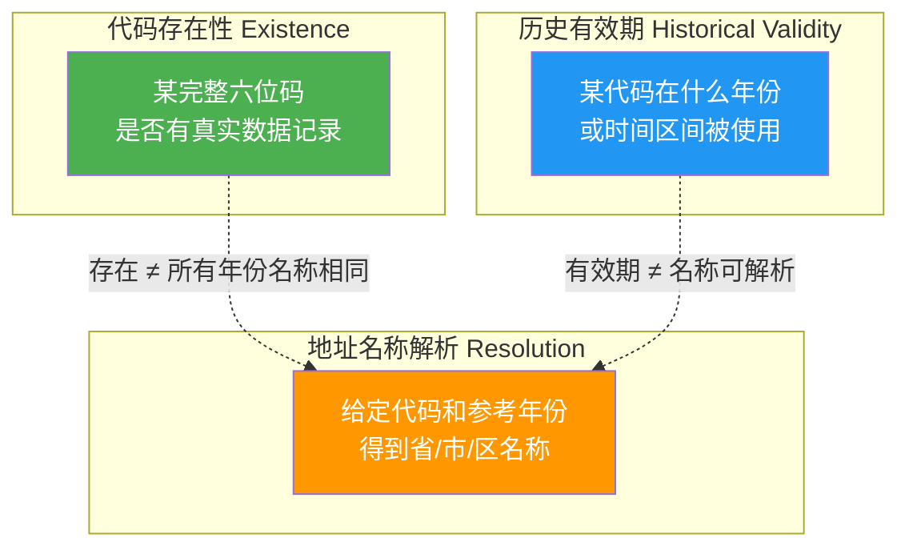
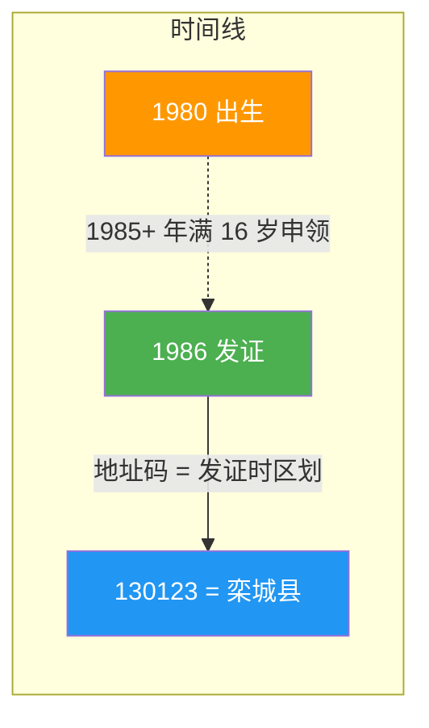
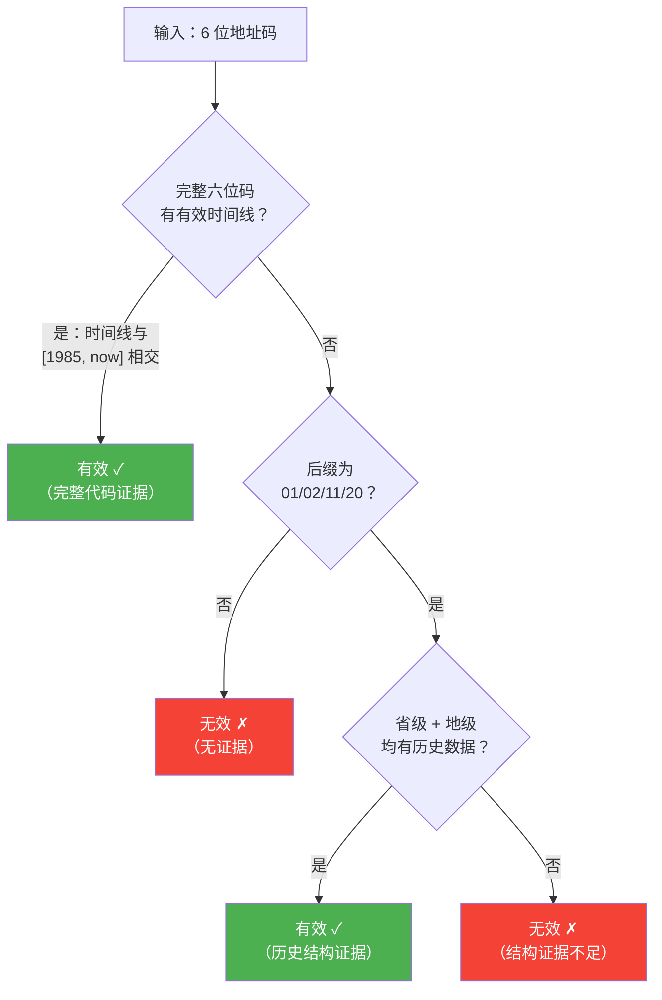
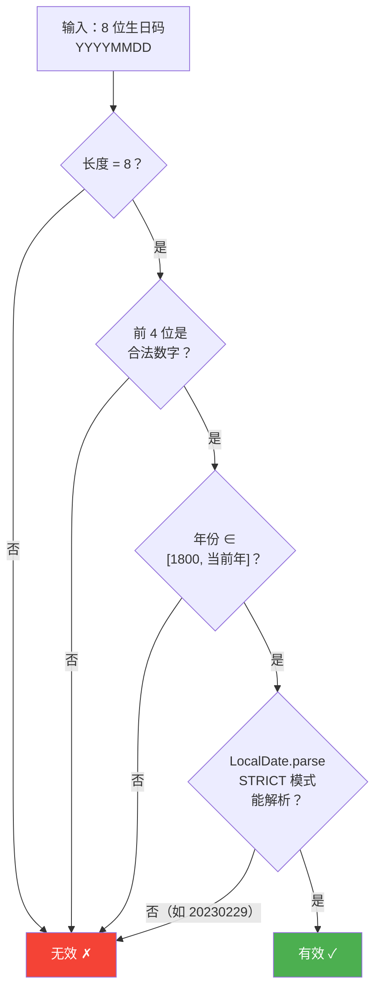
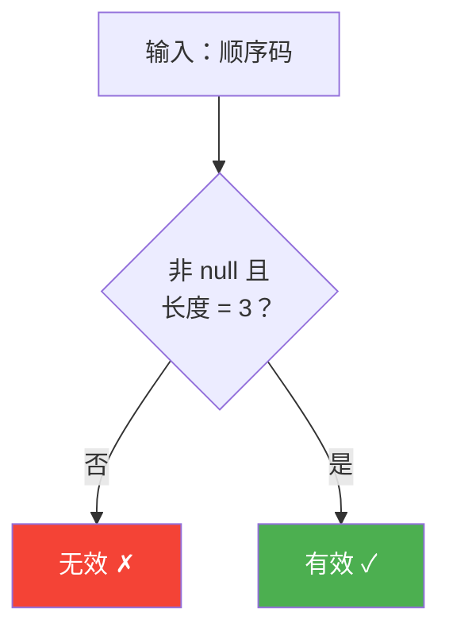
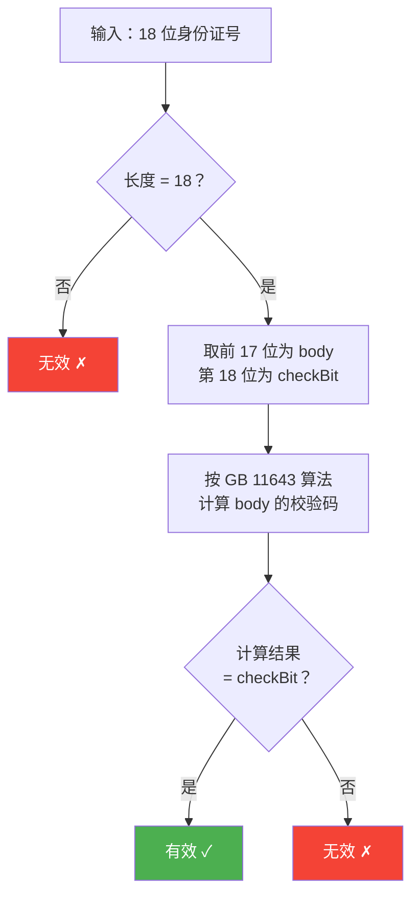
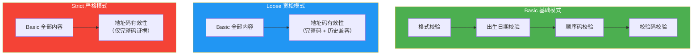
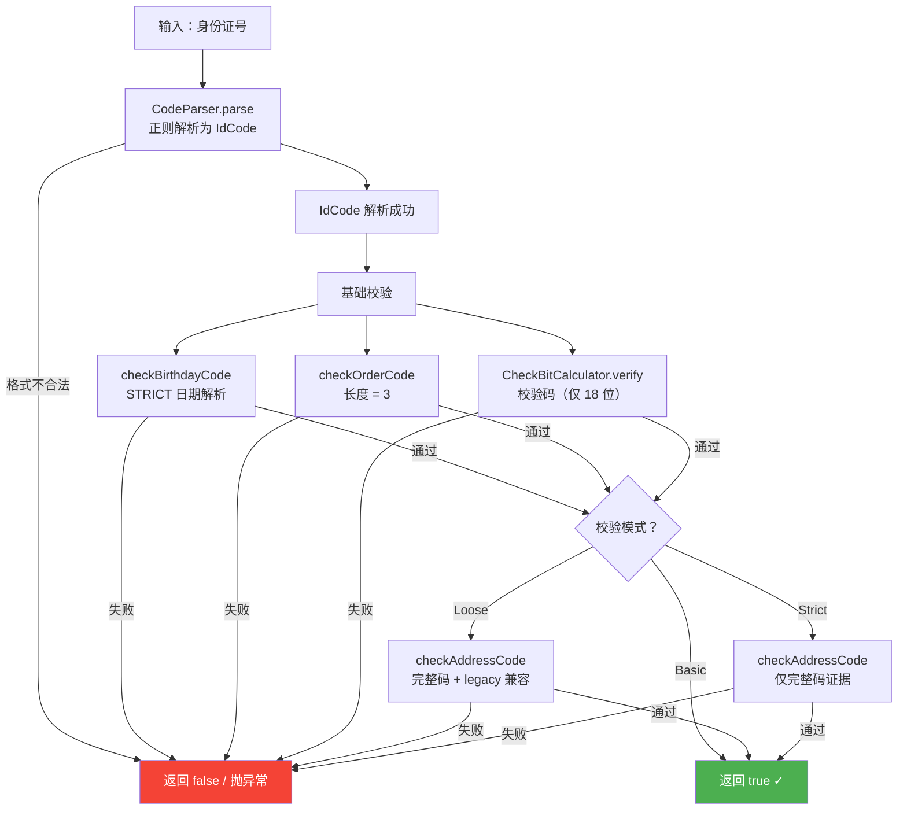
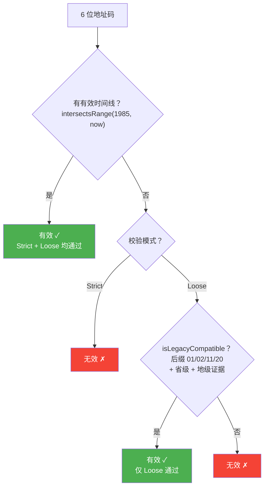
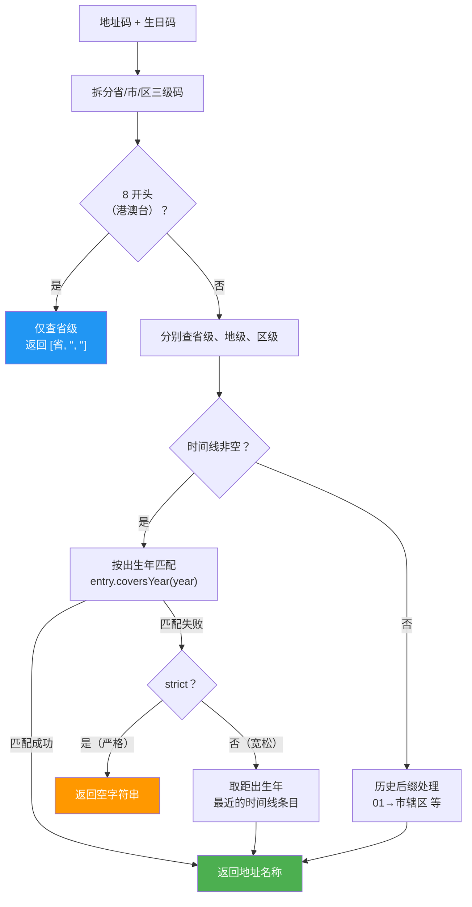

# 身份证号码业务域说明

> 本文档阐述 Chinese ID Validator 中身份证号码各组成部分的**背景知识、判断逻辑、设计依据与取舍**。
> 配套设计决策见 [地址码有效性校验设计决策](address-code-validity-design.md)。

---

## 目录

- [一、身份证号码的组成](#一身份证号码的组成)
- [二、地址码（前 6 位）](#二地址码前-6-位)
- [三、出生日期码](#三出生日期码)
- [四、顺序码](#四顺序码)
- [五、校验码](#五校验码)
- [六、三种校验模式](#六三种校验模式)
- [七、整体校验流程](#七整体校验流程)
- [八、核心设计原则](#八核心设计原则)

---

## 一、身份证号码的组成

### 1.1 国标依据

身份证号码遵循 **GB 11643-1999《公民身份号码》**，由四个逻辑部分组成：

| 组成 | 位数 | 业务含义 | 校验依据 |
|------|------|----------|----------|
| 地址码 | 6 | 登记户口所在地的行政区划编码 | 行政区划规则及历史数据 |
| 出生日期码 | 8（18 位）/ 6（15 位） | 持证人的出生日期 | 日历规则 |
| 顺序码 | 3 | 同一区域、同一出生日期的编定顺序 | 三位数字 |
| 校验码 | 1 | 18 位号码的末位校验字符 | GB 11643 校验算法 |

> **校验结果只说明号码满足约定规则，不代表真实存在某位持证人，也不代表完成实名核验。**

### 1.2 18 位身份证号结构

```
┌─地址码──┐┌──出生日期码──┐┌顺序┐┌校验┐
4 4 0 3 0 8  1 9 9 9 0 1 1 0  1 5 1  2
│←── 6 ──→││←──── 8 ─────→││←3→││←1→│
```


- **地址码**：前 6 位，反映发证时行政区划（非出生时）
- **出生日期码**：第 7–14 位，8 位 `YYYYMMDD`
- **顺序码**：第 15–17 位，奇数分配男性，偶数分配女性
- **校验码**：第 18 位，由前 17 位按 GB 11643 算法计算

### 1.3 15 位身份证号结构（第一代，1999 年前）

```
┌─地址码──┐┌出生日期┐┌顺序┐
1 3 0 1 2 3  8 0 0 1 0 1  0 0 1
│←── 6 ──→││←── 6 ─→││←3→│
```

15 位与 18 位的区别：

| 差异点 | 15 位 | 18 位 |
|--------|-------|-------|
| 出生日期码 | 6 位 `YYMMDD`，年份仅 2 位 | 8 位 `YYYYMMDD` |
| 校验码 | 无 | 有（第 18 位） |
| 年份补全 | 解析时自动补 "19" 前缀 | 不需要 |

> 15 位号的年份补 "19" 是约定规则——第一代身份证仅覆盖 1900–1999 年出生人口。

### 1.4 港澳台居民居住证

港澳台居民居住证地址码以 `8` 开头，结构与大陆居民身份证一致（18 位），但**地址码含义不同**：

| 地址码 | 地区 | 地址解析粒度 |
|--------|------|--------------|
| `810000` | 香港特别行政区 | 仅省级 |
| `820000` | 澳门特别行政区 | 仅省级 |
| `830000` | 台湾省 | 仅省级 |

港澳台码**不套用**大陆县级行政区划的六位层级结构，地址解析只返回省级名称。

---

## 二、地址码（前 6 位）

### 2.1 背景知识

地址码是身份证号中**最复杂**的部分，其复杂性源于行政区划的历史变迁。

#### 三个不同概念

行政区划代码包含三个独立的、但不等价的概念：



> 例如：代码在历史上存在，不代表其名称在所有年份都相同；出生年份也不一定是该代码被编入身份证号码的年份。

#### 发证 ≠ 出生

身份证地址码记录的是**发证时**的行政区划，而非**出生时**的行政区划：



- 一个人 1980 年出生，1985 年后（16 岁达到办证年龄）才首次申领身份证
- 地址码反映的是发证时的区划，不是出生时的区划
- 因此地址码有效性**不应依赖出生年份**

#### 身份证时代起点 = 1985 年

1985 年《居民身份证条例》施行，中国开始颁发第一代身份证。1985 年之前不存在身份证号，因此地址码不可能在 1985 年之前被使用。

#### 区划变更

同一地址码在不同时间段可能对应不同的行政区划名称：

| 地址码 | 时间段 | 名称 |
|--------|--------|------|
| `130123` | 1986–1992 | 栾城县 |
| `130123` | 1993–至今 | 正定县 |

时间线数据记录了这些变更，同一码在不同年份解析为不同名称。

### 2.2 判断逻辑

地址码有效性采用**分层证据**机制：



#### 规则 B：完整六位地址码（Strict + Loose 均适用）

优先查询现有时间线。若存在与身份证时代 `[1985, 当前年]` 相交的有效记录，则通过。

```
有效 ⟺ ∃ entry ∈ timeline(code) : [entry.start, entry.end] ∩ [1985, now] ≠ ∅
```

两个闭区间 [a₁, a₂] 与 [b₁, b₂] 相交当且仅当 `a₁ ≤ b₂ ∧ a₂ ≥ b₁`。

#### 规则 C：历史特殊后缀（仅 Loose 模式）

只有完整六位代码缺少有效时间线时，才进入历史兼容判断。

| 后缀 | 历史含义 |
|------|----------|
| `01` | 市辖区 |
| `02` | 城区 |
| `11` | 郊区 |
| `20` | 市区 |

受约束的历史兼容推断，需**同时满足**：

1. 后缀属于上述四种历史编码形式
2. 省级代码（前 2 位 + 0000）具有历史数据证据
3. 地级代码（前 4 位 + 00）具有历史数据证据

```
int suffix = addressCode % 100;
boolean legacy = suffix == 1 || suffix == 2 || suffix == 11 || suffix == 20;

int provinceCode = addressCode / 10000 * 10000;  // 例：130123 → 130000
int parentCode   = addressCode / 100 * 100;       // 例：130123 → 130100
```

> 这是对 PHP jxlwqq/id-validator 规则的**收紧**——增加上级区划约束，降低单凭后缀放行的误判风险。

#### Loose 时间语义契约

规则 C 的历史兼容有明确的**时间语义**，使用者必须知晓：

1. **Loose 接受"无法证明在 1985 年后使用过"的历史码。** 规则 C 不仅补偿数据缺失（时间线未收录的码），也补偿时间线与身份证时代不相交的码。例：`110201`（昌平县）时间线终于 1981 年，与 `[1985, 当前年]` 不相交，但因满足后缀 `01` 且省级 `110000`、地级 `110200` 证据成立，Loose 仍判定有效。当前数据中走规则 C 放行的 97 个码**全部**属于此类（完整码时间线终于 1985 年前）。
2. **上级证据是受约束的结构推断，不是历史隶属关系验证。** 省级、地级证据分别存在于某段时间，并不证明它们与该完整码在同一时期形成有效的父子关系。例：`110201` 的地级 `110200` 证据区间终于 2014 年，与 `110201` 自身时间线（终于 1981）并不相交。当前实现不引入父子时间线关联算法，此局限纳入 Loose 契约——**需要严格历史隶属验证的场景请使用 Strict。**

#### 港澳台码处理

港澳台居民居住证的地址码仅有 `810000`（香港）、`820000`（澳门）、`830000`（台湾）三个省级码（《港澳台居民居住证申领发放办法》，2018 年施行；台湾在居住证号码体系中使用 `830000`，而非 GB/T 2260 行政区划序列中的 `710000`）。

- **有效性校验**：三个码以完整六位码形态收录于时间线，条目起止年开放（默认覆盖全部年份，与身份证时代相交），因此 Strict/Loose 均凭**完整代码证据**通过——与其他地址码走同一规则，不存在港澳台特殊豁免分支。其余 `8xxxxx` 码（如 `810100`）无时间线数据，且历史后缀兼容不适用于 `8` 开头码（居住证地址码不套用县级层级结构，见 1.4），一律无效。
- **地址解析**：仅返回省级名称（见 7.3），与有效性校验相互独立。

### 2.3 数据证据层次

| 证据层次 | 定义 | 可信程度 | 适用模式 |
|----------|------|----------|----------|
| 完整代码证据 | 完整六位码有符合适用时期的时间线记录 | 高 | Strict + Loose |
| 历史结构证据 | 特殊后缀符合规则，且省级、地级码有历史数据支持 | 中 | 仅 Loose |
| 无证据 | 既无完整记录，也无法满足历史结构规则 | 不认可 | 均不通过 |

> **说明：`address_code.properties` 映射表不构成完整六位码的放行依据。** 它的唯一作用是作为规则 C 中**上级区划证据**的补充——省级/地级代码的"历史数据证据" = 时间线与身份证时代相交，**或**映射表中有记录。非遗留后缀的完整六位码即使存在于映射表，也不会被放行。
>
> 数据事实：当前内置映射表的 3209 个码全部收录于时间线且与身份证时代相交（映射表是时间线证据的真子集），即"在映射表但无时间线证据"的码在内置数据中不存在。该约束仅在自定义数据源（FALLBACK/MERGE）注入此类数据时才有区别意义，对应契约测试见 `CustomTimelineTest`。

### 2.4 设计取舍

#### 为什么不用出生年匹配？

一种直觉的"更严格"做法是检查 6 位码的时间线是否**覆盖出生年**（`entry.coversYear(birthYear)`）。但这会引入误杀：

```
130123 时间线：
  1986–1992：栾城县
  1993–至今：正定县

出生年 1980 → coversYear(1980) = false → 误判为无效
```

但该码是合法身份证数据：持证人 1980 年出生，1985+ 年领证，发证时的行政区划被编码进身份证号。**用出生年匹配会将所有 1985 年前出生但 1985 年后领证的人误杀。**

#### 为什么选 1985 年？

- 《居民身份证条例》1985 年通过并施行，中国从此开始颁发第一代身份证
- 1985 年之前不存在身份证号，地址码不可能在 1985 年之前被使用
- 1985 年是当前离线校验策略采用的历史起点，**不是**"所有合法身份证号码只能使用 1985 年后启用的地址码"的绝对法律断言

#### 为什么 legacy 兼容只用于 Loose？

结构推断（后缀 + 上级证据）不能完全证明历史代码真实存在——它只是受约束的推断。因此：

- **Strict**：要求完整代码证据，不接受结构推断
- **Loose**：允许历史结构兼容，接受中等可信度的证据

> Loose 历史兼容的时间语义与结构推断局限，见 2.2「Loose 时间语义契约」。

#### 有效性与地址解析分离

| 职责 | 方法 | 策略 |
|------|------|------|
| **有效性** | `isAddressCodeValid` / `isLegacyCompatible` | 时间线与 [1985, now] 相交，不查出生年 |
| **地址解析** | `getAddressInfo` / `getAddress` | 以出生年为启发式线索匹配时间线条目 |

> 名称解析失败，不自动推导为身份证号码无效；名称解析成功，也不自动证明完整地址码合法。两者独立。

---

## 三、出生日期码

### 3.1 背景知识

出生日期码记录持证人的出生日期：

| 格式 | 位数 | 说明 |
|------|------|------|
| 18 位身份证 | 8 位 `YYYYMMDD` | 直接使用 |
| 15 位身份证 | 6 位 `YYMMDD` | 解析时自动补 "19" 前缀 |

### 3.2 判断逻辑



#### 具体规则

1. **长度校验**：必须为 8 位
2. **年份范围**：`[1800, 当前年]`——下界 1800 覆盖最年长的身份证持有人，上界不允许未来年份
3. **日期合法性**：使用 `ResolverStyle.STRICT` 严格解析

### 3.3 设计取舍：为什么用 STRICT 解析模式

```java
DateTimeFormatter.ofPattern("uuuuMMdd")
        .withResolverStyle(ResolverStyle.STRICT);
```

Java 的 `DateTimeFormatter` 有三种解析模式：

| 模式 | 行为 | 示例 `20230229` |
|------|------|-----------------|
| `LENIENT` | 宽松，自动修正 | → 2023-02-28（悄悄修正） |
| `SMART`（默认） | 智能，部分修正 | → 2023-02-28 或抛异常（取决于实现） |
| `STRICT` | 严格，拒绝非法日期 | → 抛 `DateTimeParseException` |

使用 `STRICT` 模式可确保 `20230229`（2023 年非闰年的 2 月 29 日）、`20230431`（4 月无 31 日）等非法日期被拒绝，而非被静默修正。

> 注意使用 `uuuu` 而非 `yyyy`：`STRICT` 模式下 `yyyy` 要求同时提供 `era` 字段，`uuuu` 不需要。

---

## 四、顺序码

### 4.1 背景知识

顺序码为 3 位数字，表示同一地址码区域内、同一出生日期的人员编定顺序：

| 末位奇偶 | 性别 |
|----------|------|
| 奇数 | 男性 |
| 偶数 | 女性 |

> 顺序码为奇数分配男性、偶数分配女性，这是 GB 11643 的规定，非约定俗成。

### 4.2 判断逻辑



#### 具体规则

- **长度校验**：必须为 3 位
- **字符校验**：由正则 `\\d{3}` 保证（在 `CodeParser` 解析阶段完成）
- **性别判定**：末位奇→男，偶→女（用于 `getInfo` 信息解析，不影响有效性）

> 顺序码只校验格式，不校验"该顺序码是否真实分配过"——这是离线校验库的边界。

---

## 五、校验码

### 5.1 背景知识

18 位身份证号的末位为校验码，由前 17 位按 **GB 11643-1999 附录 B** 算法计算得出：

| 校验码 | 含义 |
|--------|------|
| `0-9` | 对应数字 |
| `X` | 罗马数字 10（`CHECK_BITS[2]`） |

> `X` 是 10 的罗马数字表示，用于避免号码变成 19 位。

### 5.2 判断逻辑



### 5.3 算法说明

```
步骤 1：17 位 body 各位乘以对应权重，累加得 sum
步骤 2：checkBitIndex = (12 - (sum % 11)) % 11
步骤 3：查表 CHECK_BITS[checkBitIndex] 得到校验字符
```

**权重数组**（位置 1~17）：

```
位置:  1  2  3  4  5  6  7  8  9  10  11  12  13  14  15  16  17
权重:  7  9  10  5  8  4  2  1  6  3   7   9  10   5   8   4   2
```

**校验码对照表**：

```
checkBitIndex:  0  1  2  3  4  5  6  7  8  9  10
CHECK_BITS:    '1','0','X','9','8','7','6','5','4','3','2'
```

> 15 位身份证无校验码，不参与此校验。

### 5.4 计算示例

以 `440308199901101512` 为例：

```
body = 44030819990110151

位置  1  2  3  4  5  6  7  8  9  10  11  12  13  14  15  16  17
数字  4  4  0  3  0  8  1  9  9  9   0   1   1   0   1   5   1
权重  7  9 10  5  8  4  2  1  6  3   7   9  10   5   8   4   2

sum = 4×7 + 4×9 + 0×10 + 3×5 + 0×8 + 8×4 + 1×2 + 9×1
    + 9×6 + 9×3 + 0×7 + 1×9 + 1×10 + 0×5 + 1×8 + 5×4 + 1×2
    = 28 + 36 + 0 + 15 + 0 + 32 + 2 + 9 + 54 + 27 + 0 + 9 + 10 + 0 + 8 + 20 + 2
    = 252

checkBitIndex = (12 - (252 % 11)) % 11 = (12 - 10) % 11 = 2
CHECK_BITS[2] = 'X'... （注：实际示例号的校验码以库计算结果为准）
```

---

## 六、三种校验模式

### 6.1 模式定义



### 6.2 校验内容矩阵

| 校验内容 | Basic | Loose | Strict |
|----------|:-----:|:-----:|:------:|
| 号码长度和字符格式 | ✓ | ✓ | ✓ |
| 真实出生日期（STRICT 解析） | ✓ | ✓ | ✓ |
| 顺序码 | ✓ | ✓ | ✓ |
| 校验码 | ✓ | ✓ | ✓ |
| 完整六位地址码时间线 | — | ✓ | ✓ |
| 受约束的历史后缀兼容 | — | ✓ | — |

### 6.3 对应 API

| API | 模式 | 等价关系 |
|-----|------|----------|
| `IdValidator.isValidBasic(id)` | Basic | — |
| `IdValidator.isLooseValid(id)` | Loose | `= isValid(id, false)` |
| `IdValidator.isStrictValid(id)` | Strict | `= isValid(id, true)` |

### 6.4 集合关系（不变量）

三种模式满足严格的集合包含关系：


```
StrictValid(id) ⟹ LooseValid(id) ⟹ BasicValid(id)
```

即：**严格通过的号码，宽松必须通过；宽松通过的号码，基础必须通过。** 这是三种模式最重要的不变量。

不变量测试：

```java
assertFalse(
    IdValidator.isStrictValid(id) && !IdValidator.isLooseValid(id)
);
```

---

## 七、整体校验流程

### 7.1 校验流程图



### 7.2 地址码校验分流



### 7.3 地址解析流程（与校验分离）



> **注意**：地址解析的 `strict` 参数与校验的 `strict` 参数虽然名称相同，但语义不同。校验 strict 控制地址码有效性证据层级；解析 strict 控制年份匹配是否回退。文档必须区分，避免调用者误解。

---

## 八、核心设计原则

### 8.1 项目定位

> Chinese ID Validator 是一个**离线身份证号码规则校验库**，不是身份真实性认证系统。

### 8.2 四条原则

| # | 原则 | 说明 |
|---|------|------|
| 1 | 基础合法性由算法判断 | 日期、校验码遵循确定性规则 |
| 2 | 地址码存在性由数据证明 | 完整六位历史时间线为主要证据 |
| 3 | 历史兼容由结构规则补充 | 特殊后缀 + 上级区划证据，受约束的推断 |
| 4 | 地址解析与号码校验分离 | 解析失败 ≠ 号码无效；解析成功 ≠ 号码有效 |

### 8.3 工程约束

- **不新增**历史例外数据集
- **不新增**常驻内存数据或索引
- **不引入**规则引擎、策略框架
- **复用**现有 DataProvider、AddressResolver、Validator
- **保持** JDK 8 兼容
- **保留**静态 API、FALLBACK/MERGE、自定义数据源机制

### 8.4 不可消除的限制

1. **结构推断不能完全证明历史代码真实存在**——因此只用于 Loose，不用于 Strict
2. **历史数据可能不完整**——Strict 返回 false 表示"当前离线规则和数据无法认可这个号码"，不应对外宣称该身份证一定是伪造的

### 8.5 最终冻结的领域设计原则

> 号码基础校验遵循确定性规则；地址码校验以完整六位历史数据为主要证据；历史特殊编码使用行政区划结构规则进行受约束的兼容判断；地址名称解析与号码有效性校验保持独立。
>
> Strict 模式要求完整代码证据，Loose 模式允许历史结构兼容，Basic 模式不依赖行政区划数据。
>
> 不通过新增历史例外数据集、缓存或规则框架解决少数历史兼容问题，优先复用已有时间线数据及标准编码规则。

---

## 参考标准

| 标准 | 说明 |
|------|------|
| GB 11643-1999《公民身份号码》 | 定义身份证号码结构、地址码含义、校验码算法 |
| 《居民身份证条例》(1985) | 身份证制度的法律起点，确认 1985 年为身份证时代起始年 |
| 《港澳台居民居住证申领发放办法》(2018) | 港澳台居民居住证制度依据 |
